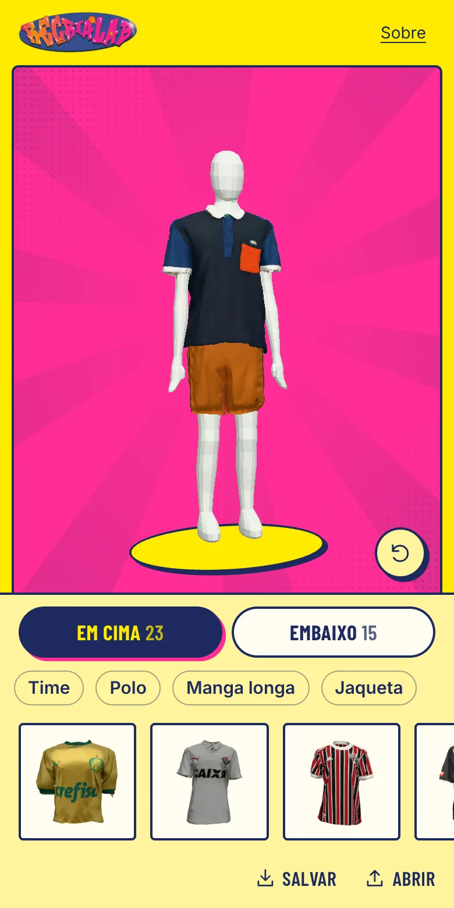

# ReCriaLab



Provador 3D de roupas de brechó: **[recrialab.com](https://recrialab.com)**

O ReCriaLab é um projeto transmídia de educação sobre moda periférica, sustentabilidade e tecnologia,
criado na disciplina de TCC em Narrativas Digitais da Unicamp. Em parceria com brechós de Jundiaí, 38
roupas reais viraram modelos 3D num provador inspirado nos jogos de vestir.

O provador foi feito para oficinas com alunos de escolas públicas: cada um monta looks com uma peça de
cima e uma de baixo, gira o manequim, salva o look como imagem, e a turma conversa sobre identidade,
consumo e criatividade. Ele roda no navegador, pensado para o celular, sem cadastro e sem guardar dados
de quem usa (há só uma contagem anônima de visitas): o look fica no próprio link
(`recrialab.com/?look=015.021`) e na imagem salva.

## Como as roupas viraram 3D

1. **Foto.** Cada peça foi fotografada no brechó.
2. **Modelo.** As fotos viraram modelos 3D no [Tripo](https://www.tripo3d.ai), que gera modelos 3D a
   partir de fotos.
3. **Caimento.** O Tripo entrega a roupa moldada num manequim de outras proporções. Scripts em Python
   ([`tools/fit/`](tools/fit/)) ajustam cada peça ao manequim do site (sem gênero nem rosto) sem esticar
   a estampa e medem o resultado: ombro, cintura, mangas e como a peça de cima cai sobre a de baixo.

Cada problema corrigido ganha um teste automático que impede que ele volte, e o site é testado em
celulares emulados antes de ir ao ar.

## Como rodar

Com o [Bun](https://bun.sh) instalado:

```sh
cd site
bun install
bun run dev      # http://localhost:3000
```

Testes, build e publicação estão em [`site/README.md`](site/README.md). As ferramentas têm cada uma o
seu README: [caimento](tools/fit/), [inspeção visual](tools/visual-qa/) e
[testes em celular](tools/verify-site/).

## Equipe e parceiros

A equipe reúne estudantes de Midialogia, Artes Visuais, Artes Cênicas e Ciência da Computação da
Unicamp; os nomes estão em [recrialab.com/sobre](https://recrialab.com/sobre). As peças vêm da curadoria
dos brechós parceiros [@moska.brecho](https://www.instagram.com/moska.brecho/) e
[@vtugarimpo](https://www.instagram.com/vtugarimpo/), de Jundiaí. O projeto está no Instagram em
[@recrialab.projeto](https://www.instagram.com/recrialab.projeto/).

## Licença

O código está sob a licença [MIT](LICENSE). As peças 3D, as texturas, as fotos e a marca ReCriaLab têm
todos os direitos reservados ([LICENSE-ASSETS.md](LICENSE-ASSETS.md)).
